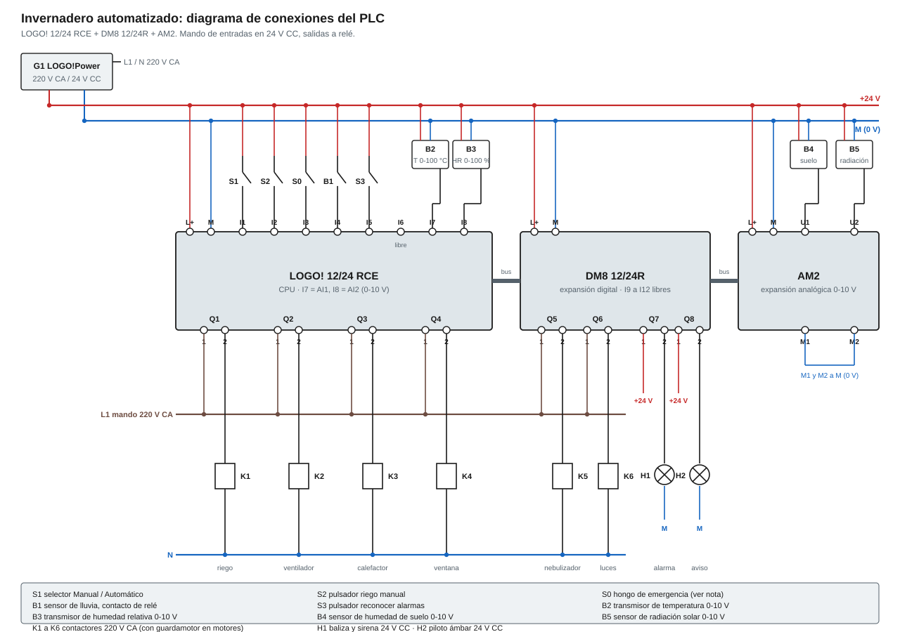

# Invernadero automatizado con LOGO!

Proyecto de Tecnología de la Automatización (UTN FRSR). Un PLC Siemens LOGO! controla el clima y el riego de un invernadero a partir de cuatro sensores analógicos y cinco entradas digitales.

- **Programa para LOGO!Soft Comfort:** [`Ejercicios/Proyecto/Invernadero.lld`](../Ejercicios/Proyecto/Invernadero.lld) (KOP) y [`Ejercicios/Proyecto/Invernadero.lsc`](../Ejercicios/Proyecto/Invernadero.lsc) (FUP)
- **Simulador web (mismo programa, con el proceso animado):** https://matiaslopez237.github.io/ProyectoAutomatizacion/ (botón **Conexiones y E/S** para ver esta tabla y el diagrama)

## Qué hace

| Función | Cómo lo resuelve el programa |
|---|---|
| Riego por horario y por humedad | Riega de 7 a 9 h y de 18 a 20 h (temporizador semanal) si el suelo está seco (≤ 30 %), hasta llegar al 45 %. Fuera de horario riega solo si el suelo está muy seco (< 15 %), y también sigue hasta pasar el 45 %: "muy seco" queda memorizado en un relé autoenclavador desde < 15 % hasta > 45 %. Al cortar, sigue 8 s más (retardo a la desconexión). |
| Detección de falla de riego | Si el aspersor lleva 10 min seguidos y el suelo no se humedeció, hay falta de agua o falla de bomba: se corta el riego automático y se enciende el aviso Q8. La falla queda memorizada (relé autoenclavador) hasta apretar *Reconocer*. |
| Contador de ciclos de riego | Cuenta los arranques del aspersor del día y se reinicia a las 0:00. Con el séptimo riego enciende el aviso Q8. |
| Ventilación por etapas | Con más de 28 °C abre la ventana cenital (si no llueve). El ventilador arranca si el calor sigue 3 min, o en el momento si hace más de 30 °C (hasta bajar a 28 °C). Con lluvia la ventana no abre y el ventilador entra sin esperar. |
| Enclavamientos | El calefactor no funciona con la ventana abierta y el nebulizador no funciona con el ventilador andando. |
| Calefacción y nebulización | Calefactor con menos de 15 °C (hasta 18 °C). Nebulizador con menos de 50 % de humedad del aire (hasta 65 %). |
| Luces de cultivo | Con poca radiación solar (< 25 %, hasta 40 %), solo entre las 6 y las 22 h. |
| Alarma con memoria | Temperatura crítica (> 38 °C) o emergencia encienden la alarma Q7, que queda encendida aunque la causa desaparezca. Se apaga con *Reconocer*, y solo si la causa ya no está. |
| Parada de emergencia | Corta todas las salidas de control y dispara la alarma. |

Todos los umbrales analógicos tienen histéresis (valor de conexión y de desconexión distintos) para que los actuadores no oscilen.

## Hardware

| Módulo | Uso |
|---|---|
| LOGO! 12/24 RCE (6ED1052-1MD08-0BA1) | CPU. 8 entradas digitales (I7 e I8 se usan como AI1 y AI2 de 0-10 V) y 4 salidas a relé de 10 A. |
| LOGO! DM8 12/24R (6ED1055-1MB00-0BA2) | Expansión digital: salidas a relé Q5 a Q8 (sus entradas I9 a I12 quedan libres). |
| LOGO! AM2 (6ED1055-1MA00-0BA2) | Expansión analógica: AI3 y AI4 (0-10 V). |
| LOGO!Power 24 V / 2,5 A | Fuente de 24 V CC para PLC, módulos, sensores y señalización. |

Hacen falta las dos expansiones porque el programa usa 8 salidas (la CPU tiene 4) y 4 entradas analógicas (la CPU puede leer 2 sin resignar entradas digitales que ya están ocupadas).

## Tabla de entradas y salidas

| Operando | Tipo | Función | Borne | Dispositivo de campo |
|---|---|---|---|---|
| I1 | Entrada digital | Selector automático (1 = automático) | LOGO! I1 | Selector Manual / Automático (contacto NA) |
| I2 | Entrada digital | Riego manual | LOGO! I2 | Pulsador NA verde |
| I3 | Entrada digital | Parada de emergencia (1 = activada) | LOGO! I3 | Pulsador de emergencia tipo hongo con enclavamiento |
| I4 | Entrada digital | Lluvia (1 = llueve) | LOGO! I4 | Sensor de lluvia con salida a relé (NA) |
| I5 | Entrada digital | Reconocer alarmas | LOGO! I5 | Pulsador NA amarillo |
| AI1 | Entrada analógica | Temperatura interior | LOGO! I7 (AI1) | Transmisor de temperatura 0-10 V (0-100 °C) |
| AI2 | Entrada analógica | Humedad relativa del aire | LOGO! I8 (AI2) | Transmisor de humedad 0-10 V (0-100 %) |
| AI3 | Entrada analógica | Humedad del suelo | AM2 U1 / M1 | Sensor capacitivo de humedad de suelo 0-10 V |
| AI4 | Entrada analógica | Radiación solar | AM2 U2 / M2 | Sensor de radiación 0-10 V |
| Q1 | Salida a relé | Aspersor de riego | LOGO! Q1 | Contactor K1: bomba / electroválvula |
| Q2 | Salida a relé | Ventilador extractor | LOGO! Q2 | Contactor K2 + guardamotor |
| Q3 | Salida a relé | Calefactor | LOGO! Q3 | Contactor K3 |
| Q4 | Salida a relé | Ventana cenital | LOGO! Q4 | Relé K4: motor de la ventana |
| Q5 | Salida a relé | Nebulizador | DM8 Q5 | Contactor K5: bomba de nebulización |
| Q6 | Salida a relé | Luces de cultivo | DM8 Q6 | Contactor K6: luminarias |
| Q7 | Salida a relé | Alarma | DM8 Q7 | Baliza roja y sirena 24 V CC |
| Q8 | Salida a relé | Aviso de riego | DM8 Q8 | Piloto ámbar 24 V CC |

Las entradas analógicas llegan al PLC como 0 a 1000 (0-10 V). Cada conmutador de umbral usa ganancia 0,1 para trabajar directamente en °C o %.

### Bloques internos

| Bloque | Función | Parámetros |
|---|---|---|
| Conmutadores analógicos de umbral | suelo húmedo · suelo muy seco · templado · calor · mucho calor · temperatura crítica · aire húmedo · hay sol | On / Off: 45/30 · 0/15 (ventana: vale 1 con el suelo por debajo de 15 %) · 18/15 · 28/25 · 30/28 · 38/35 · 65/50 · 40/25 |
| Relé autoenclavador | suelo muy seco (memoria) | S: suelo < 15 % · R: suelo > 45 % |
| Temporizador semanal | horario de riego | lunes a domingo, 07:00-09:00 y 18:00-20:00 |
| Temporizador semanal | horario de luces | lunes a domingo, 06:00-22:00 |
| Temporizador semanal | nuevo día (reinicia el contador) | lunes a domingo, 00:00-00:10 |
| Retardo a la desconexión | riego +8 s | 8 s |
| Retardo a la conexión | falla de riego | 10 min |
| Retardo a la conexión | etapa 2 de ventilación | 3 min |
| Contador adelante/atrás | ciclos de riego del día | On = Off = 7 |
| Relé autoenclavador | falla de riego (memoria) | S: 10 min sin humedecer · R: reconocer |
| Relé autoenclavador | alarma (memoria) | S: temp. crítica o emergencia · R: reconocer, sin causa presente |

## Diagrama de conexiones

- Las cargas de 220 V CA se maniobran con contactores K1 a K6, cuyas bobinas alimentan las salidas a relé. Cada motor lleva guardamotor (no se dibuja el circuito de potencia).
- El programa supone que cada entrada vale 1 cuando el dispositivo actúa. En el montaje real, el hongo de emergencia se cablea con su contacto NC (seguridad positiva) y en el programa se invierten sus contactos.
- La parada de emergencia del programa no reemplaza al corte por hardware: el hongo también abre la alimentación de las bobinas de los contactores.

El diagrama se genera con `node simulador-logo/scripts/conexiones-invernadero.mjs`.

## Cómo mostrarlo en el simulador

| Para ver | Hacer |
|---|---|
| Ventilación por etapas | Con los valores por defecto (24 °C afuera, 13:00) el interior arranca en unos 29 °C: primero abre la ventana (Q4) y a los 3 min simulados arranca el ventilador (Q2). Con 25 °C o más afuera el interior pasa de 30 °C y el ventilador arranca en el momento. |
| Lluvia | Activar I4: la ventana se cierra y el ventilador trabaja solo. |
| Riego por horario | Poner la hora en 8:00 y subir el consumo de agua del cultivo: cuando el suelo baja de 30 % riega hasta 45 %. A las 13:00 no riega hasta que baja de 15 %, y desde ahí riega hasta pasar el 45 %. |
| Falla de riego | Hora 8:00, presión de agua 0 % y consumo de agua del cultivo al máximo para que el suelo se seque rápido. Cuando baja de 30 % el aspersor se activa pero el dibujo muestra *SIN AGUA*; a los 10 min simulados se corta y se enciende el aviso Q8. Volver la presión a 100 % y apretar I5. |
| Contador de riegos | Apretar I2 siete veces (dejando terminar cada riego): con el séptimo se enciende Q8. |
| Alarma con memoria | Temperatura exterior 42 °C y sol al máximo hasta superar 38 °C adentro; después bajar la temperatura. Q7 sigue encendida hasta apretar I5. |
| Ciclo de un día | Velocidad ×300 y *Avanzar hasta medianoche*: se ven el horario de riego, las luces al atardecer y el reinicio del contador. |

## Verificación

El repositorio incluye tests automáticos que corren el programa junto con el modelo del invernadero (`simulador-logo/src/scenarios/invernadero/invernadero.test.ts`). Prueban cada una de las funciones de la primera tabla: etapas de ventilación, lluvia, enclavamientos, riego por horario y por suelo muy seco, falla de riego y reconocimiento, contador de ciclos, y alarma con memoria (incluido que no se pueda reconocer mientras la causa sigue). Se corren con `npm test` dentro de `simulador-logo/` y también en cada publicación.

El `.lld` lo arma el script `generador-lld/invernadero.bsh` con las clases de LOGO!Soft Comfort V7. Se verificó que abre en LOGO!Soft y que la lógica que compila coincide con la del simulador. El `.lsc` (FUP) sale de ese `.lld` con `generador-lld/invernadero-fup.bsh`, que usa el mismo conversor KOP → FUP de LOGO!Soft.
